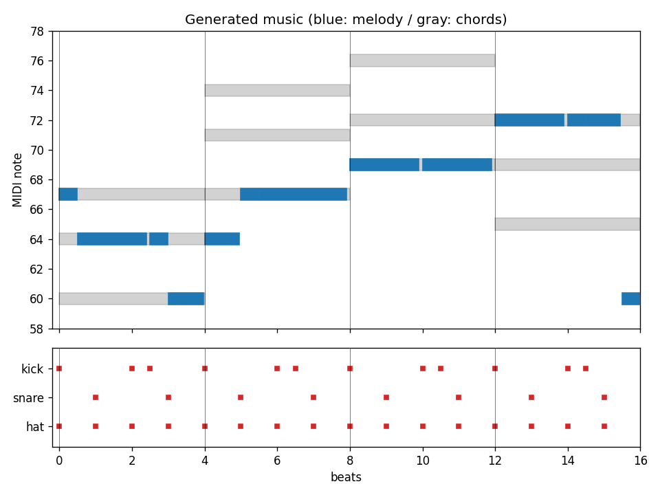
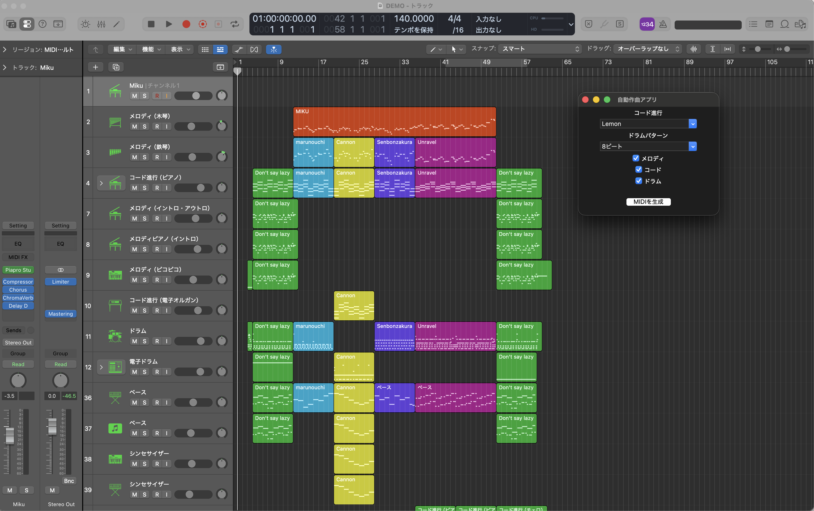

# 自動作曲アプリ（コード進行 → メロディ → ドラム → MIDI / WAV）

コード進行とドラムパターンを選ぶだけで、メロディを自動生成し、**MIDIファイル（3トラック）** と **試聴用のWAV** を出力する Python アプリです。
メロディは「コードトーンを優先する」ルールベースで作っており、DAW（作曲ソフト）がなくても、**1コマンドで生成結果を聴いて・見て**確認できます。



> 青: メロディ / 灰色: コード / 赤: ドラム（kick・snare・hat）
> 上の画像は `python demo.py`（seed=42）の出力です。

🎧 **試聴:** [`samples/sample.wav`](samples/sample.wav)（Lemon進行 × 8ビート、seed=42）
※ GitHub上では再生できないため、ダウンロードして再生してください。



## クイックスタート

```bash
pip install -r requirements.txt
python demo.py
```

`output/` に次の3ファイルが出力されます。

| ファイル | 内容 |
|---|---|
| `sample.mid` | 3トラックのMIDI（メロディ / コード / ドラム）。DAWに読み込めます |
| `sample.wav` | 簡易シンセで鳴らした試聴用の音源 |
| `piano_roll.png` | 生成結果のピアノロール画像 |

オプションで条件を変えられます。

```bash
python demo.py --progression カノン --drums Trapビート --seed 7
```

| オプション | 内容 | デフォルト |
|---|---|---|
| `--progression` | コード進行（`Lemon` / `カノン` / `千本桜` / `Don't say lazy` / `丸の内`） | `Lemon` |
| `--drums` | ドラムパターン（`8ビート` / `ダンスビート` / `Trapビート`） | `8ビート` |
| `--seed` | 乱数シード。**同じ値なら同じ曲**になります | `42` |
| `--out` | 出力フォルダ | `output` |

### GUI版

```bash
python main.py
```

コード進行とドラムをプルダウンで選び、出力するトラック（メロディ / コード / ドラム）にチェックを入れて「MIDIを生成」を押すと、保存先を選んでMIDIを書き出せます。

## 仕組み

1. **コード進行を選ぶ**（`chord.py`）
   進行名とコード名のリストを辞書で管理しています。1コード = 1小節（4拍）です。
   プリセット名は有名曲を連想させる呼び名ですが、使っているのはコード進行だけで、メロディやリズムは再現していません。
2. **メロディを生成する**（`melody.py`）
   - Cメジャースケール上で、1音ずつ決めていきます。
   - 次の音の候補は「今の音の前後2音（自分自身を含む）」です。
   - 候補の中にその小節のコードの構成音があれば**優先して選び**、なければ候補からランダムに選びます。
   - 音の長さ（0.5 / 1 / 2拍）は、**小節の残り拍数に収まるものだけ**から選びます。そのため音が小節をまたぎません。
   - 全コード分の小節（4拍 × コード数）が埋まるまで生成し、最後の音は「ド」にします。
3. **ドラムパターンを選ぶ**（`drums.py`）
   `(楽器, 拍の位置)` のリストで、1小節分のパターンを管理しています。全小節に同じパターンを繰り返します。
4. **書き出す**
   - MIDI（`midi_export.py`）: メロディ=トラック0、コード=トラック1、ドラム=トラック2。ドラムはMIDIチャンネル9、音は kick=36 / snare=38 / hat=42 です。
   - WAV（`synth.py`）: numpy だけで作った簡易シンセです。メロディとコードはサイン波＋倍音、ドラムは減衰サイン波（kick）とノイズ（snare・hat）で鳴らします。
   - 画像（`piano_roll.py`）: matplotlib でピアノロールを描きます。

## ファイル構成

```
.
├── main.py          # GUI版の入口（Tkinter）
├── demo.py          # デモモードの入口（コマンドライン）
├── chord.py         # コード進行の定義
├── melody.py        # メロディ生成
├── drums.py         # ドラムパターンの定義
├── midi_export.py   # MIDI書き出し
├── synth.py         # 簡易シンセ（WAV書き出し）
├── piano_roll.py    # ピアノロール画像の生成
├── requirements.txt
├── tests/           # テスト（unittest）
├── samples/         # 試聴用サンプル
└── docs/images/     # README用の画像
```

コード進行やドラムパターンを増やすときは、`chord.py` や `drums.py` の辞書に追加し、GUIのプルダウン（`main.py`）に名前を足します。

## テスト

標準ライブラリの `unittest` だけで動きます（追加インストール不要）。

```bash
python -m unittest -v
```

確認している内容です。

- **メロディ**: 合計拍数が「4拍 × コード数」と一致する / 音が小節線をまたがない / 全音がCメジャースケール内 / 最後が「ド」 / 同じシードなら同じ結果になる
- **コード・ドラム**: 進行のコード名がすべて定義済み / ドラムの拍位置がすべて1小節（0〜4拍未満）に収まる
- **書き出し**: WAVが期待する長さで生成され、同じ入力なら同じファイルになる / MIDIが生成できる（`midiutil` がある環境のみ）

## 制約・既知の挙動

- キーは **C（メジャー）固定**、拍子は **4/4** のみです。
- テンポは120で固定しています（MIDIはDAW側で自由に変更できます）。
- コードは基本の3和音のみで、1小節ずっと鳴らします（転回やテンションは未対応）。
- ドラムは全小節で同じパターンの繰り返しです。
- メロディの最後の音は、最終小節のコードに関係なく「ド」に固定しています（終止感を出すための仕様です）。
- WAVは確認用の簡易シンセのため、音色はシンプルです。音作りをしたい場合は、MIDIをDAWに読み込んでください。
- メロディはルールベースのランダム生成で、機械学習は使っていません。

## 動作環境

- Python 3.10 以上（動作確認: 3.12）
- `midiutil` / `numpy` / `matplotlib`
- GUI版のみ Tkinter が必要です（Python標準。Windows版の公式インストーラには同梱されています）

## 今後の改善案

- キー（調）の選択、メジャー / マイナーの切り替え
- コードのリズム（分散和音・刻み）やドラムのバリエーション
- メロディのモチーフ反復（同じフレーズを繰り返す）
